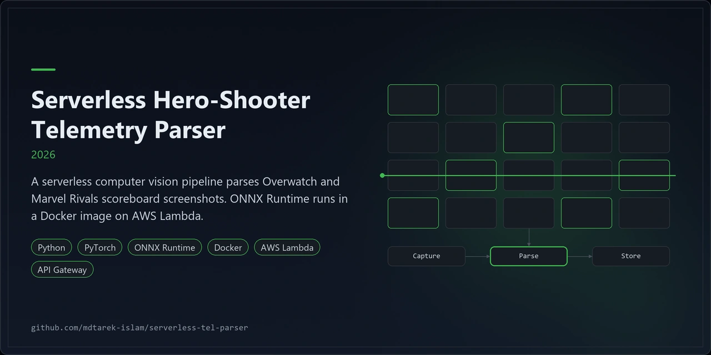
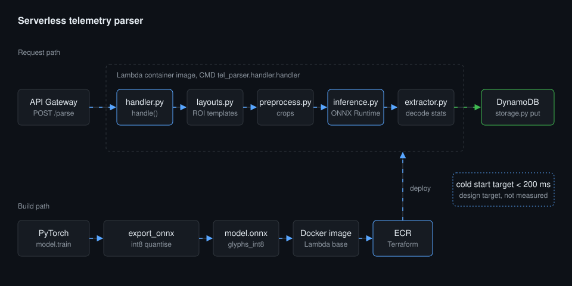
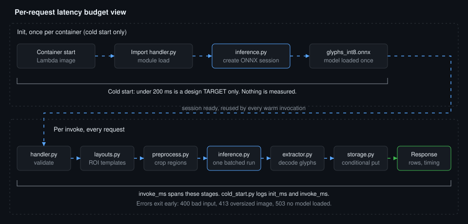

<p align="center"></p>

# Serverless Hero-Shooter Telemetry Parser

A serverless pipeline that reads hero-shooter scoreboard screenshots with ONNX Runtime on AWS Lambda.

## Overview

A serverless computer vision pipeline parses Overwatch and Marvel Rivals scoreboard screenshots. ONNX Runtime runs in a Docker image on AWS Lambda. An HTTP API accepts a screenshot, reads the stat glyphs with a small CNN and stores one row per player in DynamoDB.

The project is at an early stage. No trained model ships in the repository, and no deployment has been run.

| Layer | Technology |
|---|---|
| Language | Python 3.12 |
| Training | PyTorch |
| Inference | ONNX Runtime, int8 dynamic quantisation |
| Packaging | Docker (AWS Lambda Python 3.12 base image) |
| Compute and API | AWS Lambda, API Gateway HTTP API |
| Storage | DynamoDB |
| Infrastructure | Terraform |

## Architecture



1. API Gateway receives `POST /parse` and passes the body to the Lambda container.
2. `handler.py` validates the request and calls a testable `handle()` function.
3. `layouts.py` selects the region-of-interest templates for the game and screen resolution.
4. `preprocess.py` crops each region with PIL and numpy.
5. `inference.py` runs all crops in one batched ONNX Runtime call. The session is created at import for warm reuse.
6. `extractor.py` decodes glyph predictions into player stats.
7. `storage.py` writes rows to DynamoDB with an idempotent conditional put.
8. The build path trains the glyph model, exports and quantises it, then packs it into the image pushed to ECR.



The second view splits the work into init that runs once per container and stages that run on every invoke. The 200 ms cold start is a target, not a measurement.

## Features

- Two games: Overwatch and Marvel Rivals, each with per-resolution layouts.
- Input as `image_base64` or as an `s3_key` read from one configured bucket.
- One batched inference call per request.
- Idempotent writes keyed on `match_id` and `player_slot`.
- `cold_start.py` logs `init_ms` and `invoke_ms` for every invocation.
- Error codes: 400 for bad input, 413 for an oversized image, 503 when no model is loaded.
- Terraform for ECR, a Lambda image function, an HTTP API, a DynamoDB table (PAY_PER_REQUEST) and least-privilege IAM.

### Engineering findings

- Tests: 58 passed, 3 skipped. The skips need onnxruntime and torch, which were absent from the test environment.
- Model: a small PyTorch glyph CNN with 37 classes (blank, digits, letters A to Z). No trained model is in the repository.
- Layouts: all ROI templates are estimates with `calibrated=False`. They need calibration against real screenshots.
- Cold start: under 200 ms is a design target only. No cold start has been measured.
- Not yet verified: `docker build`, `terraform validate`, a run of `export_onnx`, and any real deployment.
- Without a model file the handler returns 503 for every parse request.

## Quick start

```bash
git clone https://github.com/mdtarek-islam/serverless-tel-parser.git
cd serverless-tel-parser
python -m venv .venv
source .venv/bin/activate          # Windows: .venv\Scripts\activate
pip install -r requirements-dev.txt
python -m pytest
```

Train and export a model. Put labelled glyph images under `data/glyphs` first.

```bash
pip install -r requirements-train.txt
python -m tel_parser.model.train --data data/glyphs
python -m tel_parser.model.export_onnx --weights model/glyphs.pt
```

Build the image and deploy.

```bash
docker build -t tel-parser .
# Push the image to the ECR repository, then:
cd terraform
terraform init
terraform apply -var image_tag=<tag>
```

Training writes `model/glyphs.pt`. Export writes `model/glyphs_fp32.onnx` and `model/glyphs_int8.onnx`.

## Configuration

Set these environment variables on the Lambda function. Terraform sets the table and bucket values.

| Variable | Default | Purpose |
|---|---|---|
| `TEL_MODEL_PATH` | `/var/task/model/glyphs_int8.onnx` | Path to the int8 ONNX model |
| `TEL_TABLE_NAME` | empty | DynamoDB table. Rows are not stored when empty |
| `TEL_SCREENSHOT_BUCKET` | empty | S3 bucket for `s3_key` requests |
| `AWS_REGION` | `eu-west-2` | Region for AWS clients |
| `TEL_MAX_IMAGE_BYTES` | `4000000` | Largest accepted image |
| `TEL_LOG_LEVEL` | `INFO` | Python log level |

Terraform variables in `terraform/variables.tf`: `image_tag` (required), `project_name` (`tel-parser`), `aws_region` (`eu-west-2`), `architecture` (`x86_64`), `memory_mb` (1024), `timeout_seconds` (15), `screenshot_bucket` (empty, disables S3 access) and `log_retention_days` (14).

## Usage

Send a screenshot to the HTTP API. Read the URL from the `parse_url` Terraform output.

```bash
curl -X POST "$(terraform output -raw parse_url)" \
  -H "content-type: application/json" \
  -d "{\"game\": \"overwatch\", \"image_base64\": \"$(base64 -w0 scoreboard.png)\", \"match_id\": \"m-001\"}"
```

Request fields:

- `game`: `overwatch` or `marvel_rivals`.
- `image_base64` or `s3_key`: the screenshot, PNG or JPEG.
- `match_id`: optional. Rows are stored only when it is present.

The response holds `game`, `rows`, `persisted` and a `timing` object with `cold_start`, `init_ms` and `invoke_ms`.

## Licence and contribution

This project uses the MIT licence. See [LICENSE](./LICENSE). Raise bugs and suggestions as GitHub issues on this repository.

### Branches

- `main` holds production code and the maintenance, security and CI office.
- `generator` holds the research and build office.
- Code moves to `main` only through the merge-to-main command.

CI runs from `.github/workflows/ci.yml` on pushes and pull requests to `main`. It runs:

- Secret scan: gitleaks and a regex fallback.
- Dependency audit with pip-audit and a bandit security scan.
- Quality: ruff, mypy and pytest.
- Governance audit.
- Terraform: fmt check and validate.
- Docker build of the Lambda image, with no push.

Repository governance: the audit step checks `CLAUDE.md` and the `.claude/` folder.

## Maintenance status

Experimental. The code and tests exist, but there is no trained model, no calibrated layout and no deployment, and the repository is on upload hold.
